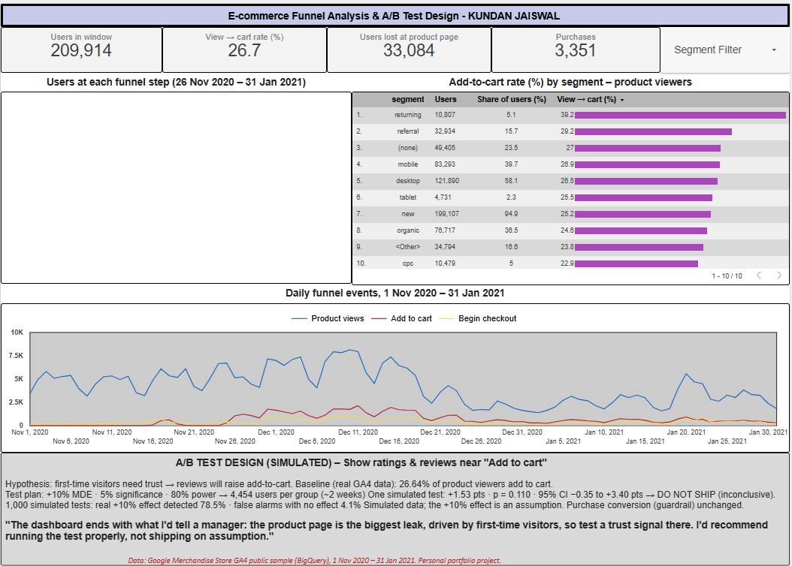
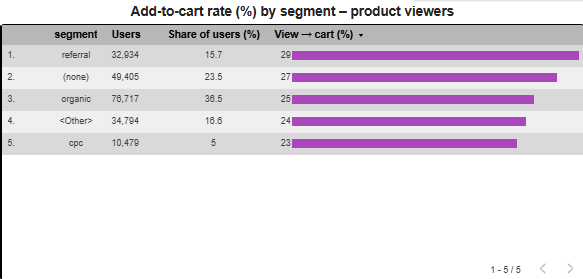

# E-commerce Funnel Analysis & A/B Test Design (GA4)

**Personal portfolio project** · BigQuery (SQL) · Python (Colab) · Data Studio (formerly Looker Studio)
Data: Google Merchandise Store GA4 public sample in BigQuery

---

## Business question
**Where do visitors drop out of the purchase funnel, and which visitors drop out most?**
**Decision supported:** which funnel step to fix first, and what to A/B test there.

## Key result
- **The product page is the biggest leak:** only **26.7%** of product viewers add to cart — **33,084 users lost**, more than at any later step.
- **First-time visitors drive it:** they are **~90% of product viewers** and add to cart at **25.2% vs 39.2%** for returning visitors. Device and channel show no comparable gap.
- **Recommendation:** test a trust signal (ratings & reviews near "Add to cart") for first-time visitors. Designed test: **4,454 users per group, ~2 weeks**; simulation confirms **78.5% power** and a **4.1% false-positive rate**.



---

## Data
- **Source:** `bigquery-public-data.ga4_obfuscated_sample_ecommerce` (Google's public, obfuscated GA4 export of its Merchandise Store)
- **Size:** 4,295,584 events · 270,154 users · 1 Nov 2020 – 31 Jan 2021
- **Analysis window:** 26 Nov 2020 – 31 Jan 2021 (209,914 users) — see data quality below

## Method

**1. Data exploration** — schema (incl. nested STRUCT and ARRAY fields via `INFORMATION_SCHEMA`), event types, size and date range.

**2. Data quality validation** — `add_to_cart` was **not tracked until 25 Nov 2020** (0 on most days while checkouts were recorded). Found by checking daily counts and confirmed with a SQL rule that returns only broken days. → Analysis limited to 26 Nov 2020 – 31 Jan 2021.

**3. Funnel construction** — user-level funnel (distinct users, not events), using CTEs and 1/0 step flags:

| Step | Users | Conversion from previous step |
|---|---|---|
| View item | 45,107 | 21.5% of all users |
| Add to cart | 12,023 | **26.7%** |
| Begin checkout | 6,509 | 54.1% |
| Add payment | 4,253 | 65.3% |
| Purchase | 3,351 | 78.8% |

**4. Segmentation** — view → cart rate by segment:
- **Device:** desktop 26.5% · mobile 26.9% · tablet 25.5% → site-wide, not device-specific
- **Channel (first touch):** referral 29.2% · direct 27.0% · organic 24.6% · paid search 22.9% → largest channels close to average
- **User type:** new 25.2% · returning 39.2% → **first-time visitors are the main issue**



**5. A/B test design (Python)** — hypothesis: *showing ratings and reviews near "Add to cart" raises add-to-cart, because first-time visitors need trust.*
- Baseline taken directly from BigQuery: **26.64%** of product viewers add to cart
- +10% minimum detectable effect · 5% significance · 80% power → **4,454 users per group (~2 weeks)**
- Primary metric: add-to-cart rate · Guardrail: purchase conversion

**6. Simulation (Python)** — the experiment is **simulated** (the baseline is real; the +10% effect is an assumption):
- **One test:** +1.53 pts, p = 0.110, 95% CI −0.35 to +3.40 pts, guardrail OK → **do not ship (inconclusive)**
- **1,000 repeated tests:** real +10% effect detected **78.5%** of the time; false alarms with no effect **4.1%** → the design works as planned
- Lesson: one test can miss a real effect, so "not significant" means *no clear evidence*, not *no effect*.

**7. Dashboard (Data Studio)** — three reporting tables built in BigQuery (funnel steps, segments, daily events), connected to a one-page dashboard.

---
## Repository structure
```
├── README.md
├── ab_test_simulation.ipynb     # A/B test design, simulation and analysis (Python)
├── dashboard.png                # full dashboard screenshot
├── segments_channel.png         # segment table, channel view
└── sql/
    └── funnel_analysis.sql      # all SQL: exploration, data quality, funnel, segments, dashboard tables
```

## Skills shown
SQL (CTEs, window functions `LAG` / `OVER (PARTITION BY)`, `UNNEST`, `UNION ALL`, nested GA4 fields) · data quality checks · funnel and segmentation analysis · experiment design (power analysis, SRM check, two-proportion z-test, confidence intervals, guardrail metrics) · Monte Carlo simulation · Python (pandas, numpy, scipy, statsmodels) · BigQuery → Python connection · dashboarding

## How to reproduce
1. Create a free BigQuery sandbox project (no billing needed).
2. Open `sql/funnel_analysis.sql` and run each query in BigQuery, one at a time. Replace `funnel-portfolio-514915` with your own project ID for the dashboard tables.
3. Open `ab_test_simulation.ipynb` in Google Colab, set your project ID in the BigQuery step, then **Runtime → Run all** (sign in when asked).
4. For the dashboard: in Data Studio, add the three tables in `funnel_dashboard` as BigQuery data sources.

---

## Limitations
- **Public, obfuscated sample data** — shows the method, not the store's current performance. Some fields are redacted.
- **Tracking gap:** `add_to_cart` missing until 25 Nov 2020, so the window is 67 days and includes the **holiday peak** — not a "normal" period.
- **Users = browser cookies**, not people; cleared cookies or a new device count as a new user.
- **Open funnel:** steps are not required to happen in order.
- **Segments:** ~1.3% of users used more than one device; one is assigned per user, so segment rates can shift slightly between runs. Segment differences were not tested for significance. The new vs returning gap is correlational, not causal.
- **Channel** = first-touch acquisition channel; ~19% of users have a grouped or redacted channel. "(data deleted)" (~2.7%) is excluded from the channel view.
- **The A/B test is simulated:** the +10% effect is an assumption; purchase is simulated as unchanged and independent of add-to-cart.

## Next steps
- Session-level funnel using `UNNEST(event_params)` to get the session ID
- Strict, ordered funnel (steps counted only in sequence)
- Significance tests on segment differences
- Run the reviews test as a real experiment; test clearer product information next
